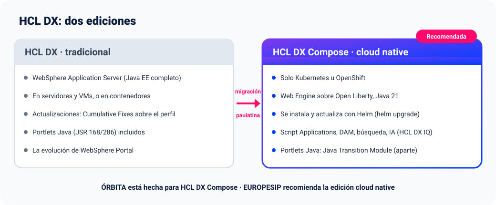

# ÓRBITA · Preguntas frecuentes

[English](faq.md) · **Español** · [README](../README.es.md)

- [El producto](#el-producto)
- [HCL DX tradicional y DX Compose](#hcl-dx-tradicional-y-dx-compose)
- [Coste y licencia](#coste-y-licencia)
- [Instalación](#instalación)
- [Theme y DAM](#theme-y-dam)
- [Inteligencia artificial](#inteligencia-artificial)
- [Idiomas y localización](#idiomas-y-localización)
- [Seguridad y datos](#seguridad-y-datos)
- [Tecnología](#tecnología)
- [Servicios de EUROPESIP](#servicios-de-europesip)
- [Contacto](#contacto)

## El producto

**¿Qué es ÓRBITA?**
Una intranet de autoservicio para la plantilla sobre **HCL DX Compose**: fichaje (también desde un quiosco con PIN o
tarjeta QR), vacaciones y ausencias, gastos y viajes, aprobaciones, comunicación con RR. HH., una página de inicio con el día de cada persona y un
asistente de IA que responde y actúa por cada empleado. La hace **EUROPESIP**.

**¿Para quién es?**
Para organizaciones que tienen, o quieren tener, su intranet en HCL DX, y para partners de HCL que quieren una
aplicación real y completa para enseñar lo que puede hacer DX Compose. Empleados, responsables, RR. HH. y
Administración ven cada uno lo suyo.

**¿Qué versión de HCL DX necesita?**
**HCL DX Compose CF239** (Kubernetes u OpenShift). Usa las funciones de DX: Script Applications, la sesión de DX, el
DAM, los themes por WebDAV y, opcionalmente, HCL DX IQ. Por qué DX Compose y no la edición tradicional:
[HCL DX tradicional y DX Compose](#hcl-dx-tradicional-y-dx-compose).

**¿Sustituye a nuestro software de RR. HH. o de nóminas?**
No. ÓRBITA cubre los procesos del día a día de la plantilla dentro del portal. Puede intercambiar datos con vuestros
sistemas de RR. HH., nóminas o ERP (incluye exportaciones CSV; las integraciones directas son un
[servicio](#servicios-de-europesip)).

**¿Puede RR. HH. comunicarse con la plantilla con ÓRBITA? ¿Las encuestas de pulso son anónimas de verdad?**
Sí. La aplicación **Comunicación con RRHH** tiene comunicados (a toda la plantilla, a un departamento o a un rol, con
control de lectura y de confirmación), consultas privadas a RR. HH. (solo las ven el empleado y RR. HH., no su
responsable), encuestas de pulso anónimas y preguntas frecuentes. El pulso es **anónimo por diseño**: las respuestas se
guardan sin usuario ni hora, los resultados solo se muestran cuando ha respondido un mínimo de personas (5 por defecto,
nunca menos de 3), se oculta un departamento si se pudiera deducir por resta y la IA no puede responder encuestas.

**¿Se puede probar con datos de ejemplo?**
Sí. Por defecto el chart carga datos de demostración (personas, fichajes, vacaciones, notas de gasto) asignados a tus
usuarios de DX (valor `demo.people`), y RR. HH. puede restaurarlos desde la aplicación. Los datos de la demo están en
español.

## HCL DX tradicional y DX Compose

**¿Por qué debería saber que HCL DX tiene dos ediciones?**
Porque es importante para ÓRBITA: la edición de HCL DX que uses influye en la versión de ÓRBITA a instalar y en el
proceso de instalación.

**¿Hay dos versiones de HCL DX?**
Sí. HCL Digital Experience tiene dos ediciones:
- **HCL DX tradicional.** La evolución de WebSphere Portal. Se ejecuta sobre **WebSphere Application Server**, en
  servidores y máquinas virtuales (o en contenedores), y se actualiza con Cumulative Fixes aplicados a su perfil.
- **HCL DX Compose.** La edición **cloud native**. Se ejecuta **solo en Kubernetes u OpenShift**, con un Web Engine
  más ligero sobre **Open Liberty** y Java 21. Se instala y actualiza con charts de Helm, e incluye en la plataforma
  el DAM, la búsqueda y el asistente de IA (HCL DX IQ).

**¿Cuál recomendáis?**
**HCL DX Compose.** Usa una tecnología más moderna (contenedores, Kubernetes, Open Liberty, Java 21) y tiene muchas
ventajas: instalaciones y actualizaciones más rápidas, escalado y alta disponibilidad de la mano de Kubernetes, el
mismo despliegue en tus instalaciones o en cualquier nube, y las novedades, como HCL DX IQ, llegan antes ahí.
EUROPESIP evaluó las dos ediciones y se decidió por la cloud native: ÓRBITA está hecha para HCL DX Compose.

**¿Cuál es la mayor ventaja en la práctica?**
**La rapidez.** Una versión nueva de DX Compose es una versión nueva del chart, que se aplica con `helm upgrade` en
minutos; una instalación desde cero lleva menos de una hora. Eso es también lo que hace que ÓRBITA se instale de forma
sencilla y rápida: un chart de Helm junto a DX, y los [laboratorios de HCL DX Compose](https://github.com/europesip/hcl-dx-compose-labs)
instalan la plataforma entera paso a paso.

**Usamos la versión tradicional de HCL DX. ¿Qué nos aconsejáis?**
Nuestro consejo: **actualizar**, y dentro de ese proyecto abordar una **migración paulatina a HCL DX Compose**,
llevando contenidos, aplicaciones y usuarios por etapas en lugar de todo a la vez. Nuestro equipo de servicios os puede
ayudar en ese upgrade. No obstante, si por cualquier motivo preferís no cambiar de edición y seguir en la tradicional,
pero a la vez queréis utilizar ÓRBITA, también es posible: EUROPESIP puede ayudaros, como
[servicio](#servicios-de-europesip), a instalarla o adecuarla a vuestra plataforma actual.

**¿Las instrucciones y guías de ÓRBITA sirven para HCL DX tradicional?**
Las instrucciones y guías de ÓRBITA están orientadas a **HCL DX Compose**, la edición cloud native, que es la que
aconsejamos. No obstante, si lo que deseas es instalarla en HCL DX tradicional, [contacta con nosotros](#contacto) y
te ayudaremos.

**¿Por qué usáis Script Applications y no portlets en Java?**
Hacer la misma solución con portlets Java no nos hubiera costado nada: de hecho, ÓRBITA nació en **WebSphere Portal
9.0** con esa tecnología. Al llevarla a HCL DX Compose, sobre Open Liberty, la pasamos a **Script Applications** por
dos motivos:
- **Los portlets Java propios necesitan una licencia aparte en DX Compose.** No se pueden desplegar portlets propios
  sin haber comprado el **Java Transition Module for DX Compose** ([limitaciones de DX Compose](https://help.hcl-software.com/digital-experience/dx-compose/latest/getting_started/product_overview/limitations/)). Las Script
  Applications forman parte de DX Compose, sin nada más que comprar.
- **El mismo resultado, al alcance de más gente.** Con Script Applications (aquí, React) se consiguen las mismas
  funciones, y cualquier desarrollador web puede mantener o ampliar la solución, sin conocer portlets Java ni
  necesitar licencias adicionales.

## Coste y licencia

**¿Es realmente gratuito?**
Sí. ÓRBITA es de código abierto con **licencia MIT**: sin coste de licencia, sin precio por usuario y sin límite de
tiempo. El código fuente completo, el chart de Helm, las imágenes de contenedor y los manuales son públicos.

**¿Podemos usarlo con fines comerciales, modificarlo o incluirlo en nuestra oferta?**
Sí. La licencia MIT permite usarlo, copiarlo, modificarlo, distribuirlo y venderlo, también comercialmente, siempre que
se mantenga el aviso de copyright y de licencia.

**Entonces, ¿qué cuesta dinero?**
Lo que ÓRBITA necesita para funcionar: tu licencia de HCL DX Compose, el clúster de Kubernetes, la base de datos
PostgreSQL y, si usas el asistente de IA, el modelo (propio, o los tokens de un proveedor). EUROPESIP solo cobra los
[servicios opcionales](#servicios-de-europesip) que pidas.

**¿Tiene garantía o soporte oficial?**
El software se entrega tal cual (ver [LICENSE](../LICENSE)). El soporte profesional, el mantenimiento y las
actualizaciones están disponibles como servicio de EUROPESIP. ÓRBITA no es un producto de HCL ni tiene soporte de HCL.

## Instalación

**¿Qué necesito?**
HCL DX Compose CF239, Helm, PostgreSQL (ÓRBITA crea su propia base de datos y usuario), un administrador de DX para
DXClient y la CA del certificado de DX. Para el asistente de IA, un LiteLLM o cualquier API compatible con OpenAI
(opcional).

**¿Cómo se instala? ¿Cuánto tarda?**
Con **un comando de Helm** (README, *Instalación con Helm*), en unos 3 minutos. El chart crea la base de datos, despliega
la API, sube las siete Script Applications con DXClient y crea sus páginas y el theme de ejemplo. Hay una guía paso a
paso en el **Lab 5** de los [HCL DX Compose labs](https://github.com/europesip/hcl-dx-compose-labs).

**Quiero probar ÓRBITA, pero no tengo acceso a ningún entorno Kubernetes con DX Compose.**
Para esos casos puedes crearte un sandbox temporal con el [Instalador de HCL DX Compose](https://github.com/europesip/hcl-dx-compose-installer), un proyecto
experimental de EUROPESIP que instala HCL DX Compose (y ÓRBITA con él) en tu PC, en un clúster existente o en AWS.

**¿Necesito HCL DX IQ?**
No. ÓRBITA tiene su propio asistente de IA. HCL DX IQ es una integración opcional.

**¿Se puede instalar sin IA?**
Sí: `assistant.backend: none` oculta el asistente; todo lo demás funciona igual.

**¿Puedo poner las aplicaciones en mis propias páginas?**
Sí: `pages.create: false` sube las Script Applications a WCM y tú las añades a las páginas que quieras.

**Nuestro clúster no tiene acceso a internet. ¿Podemos usar un registro privado?**
Sí. Copia las imágenes (`ghcr.io/europesip/orbita/orbita-api` y `orbita-scriptapps`, amd64 y arm64) a tu registro y
ajusta `image.repository`, `scriptapps.bundle.image` e `imagePullSecrets`.

**¿Cómo se actualiza? ¿Se conservan los datos?**
`helm upgrade` con la versión nueva. Los cambios de la base de datos son migraciones Flyway que se aplican al arrancar,
así que los datos se conservan. Las páginas que ya existen conservan su diseño y los ajustes de cada aplicación.

**¿Cómo se desinstala?**
`helm uninstall`. Se quedan la base de datos, las Script Applications, las páginas, el theme y la colección del DAM
(pueden estar en uso); bórralos en DX y en PostgreSQL si ya no los necesitas.

## Theme y DAM

**¿ÓRBITA necesita un theme propio?**
No, funciona con cualquier theme de DX. Por defecto el chart añade un **theme de ejemplo** para enseñar una intranet
terminada sobre HCL DX.

**¿Qué hace el theme de ejemplo?**
Es una copia del theme **Portal 8.5** de HCL DX con una cabecera de ÓRBITA: el **logo de la empresa**, **«Powered by HCL
Software»** y un **botón que abre el asistente de ÓRBITA**. La barra de herramientas, los menús, la búsqueda y el modo
edición son los de Portal 8.5. Se asigna solo a las páginas de ÓRBITA: el resto del portal mantiene su theme.

**¿Por qué se copia de nuestro DX al instalar?**
Los ficheros del theme son de HCL, así que no van con ÓRBITA: el chart los copia de **tu propio DX** (WebDAV) y cambia
solo la cabecera. No necesita EAR ni código Java, así que encaja en el modelo de DX Compose.

**¿Cómo ponemos el logo de nuestra empresa?**
Las imágenes están en la **colección `ÓRBITA` del DAM**. Sube allí una nueva versión de `company-logo.png` y el theme la
muestra (usa siempre la última versión). O dalo al instalar: `--set theme.logoBase64=$(base64 -w0 logo.png)`.

**¿Se puede ocultar el logo de HCL o el botón del asistente?**
Sí: `theme.hclLogo: false` y `theme.assistantButton: false`.

**¿Podemos usar nuestro theme corporativo?**
Sí: `theme.enabled: false` mantiene el theme que tengan tus páginas. Después, con `ui.header.*` ocultas en las
aplicaciones lo que tu theme ya muestra (usuario, avisos…). Adaptar tu theme a ÓRBITA, o ÓRBITA a tu theme, es un
[servicio](#servicios-de-europesip).

**¿Quién ve las imágenes del DAM?**
Son logos, así que la colección se puede leer sin restricciones (usuarios anónimos y con sesión). Solo los
administradores de DX pueden cambiarlas.

**¿Cada página puede tener ajustes distintos?**
Sí. En el **modo edición** de DX, «⚙ Ajustes de esta aplicación» elige las partes de la cabecera, el pie y el idioma de
esa aplicación en esa página. Los ajustes se mantienen al actualizar.

## Inteligencia artificial

**¿Qué puede hacer el asistente?**
Responder y actuar por el empleado que pregunta: su día, fichar entrada y salida, saldo y solicitudes de vacaciones,
notas de gasto (crear, añadir gastos, enviar), aprobaciones para los responsables, comunicados, consultas a RR. HH. y
encuestas de pulso, y avisos. 33 herramientas en total;
tú eliges cuáles se publican (`mcp.tools`). Más de 60 preguntas de ejemplo: [preguntas-ia.md](preguntas-ia.md).

**¿Qué es un servidor MCP?**
MCP (Model Context Protocol) es el estándar abierto que permite a un asistente de IA usar las herramientas de una
aplicación: consultar sus datos y actuar en ella, en nombre del usuario. ÓRBITA incluye su propio **servidor MCP con más
de 30 herramientas** (33) para trabajar con ÓRBITA: fichaje, vacaciones, gastos, aprobaciones, comunicación con RR. HH. y
avisos. Las usa su
asistente propio, y también HCL DX IQ o cualquier otro cliente MCP.

**¿Se puede ampliar la IA más allá de las herramientas de ÓRBITA?**
Sí. La IA se puede ampliar y personalizar según lo que necesite cada empresa:

- **Más herramientas**: nuevas herramientas MCP para ÓRBITA, o para vuestros otros sistemas (RRHH, ERP, tickets…), para
  que el asistente también responda y actúe en ellos, siempre como el usuario que pregunta.
- **RAG (generación aumentada con recuperación)**: acceso a vuestra información propia, como las políticas de la
  empresa, el convenio, la política de viajes y gastos o los procedimientos internos, para que las respuestas sigan
  vuestras normas («¿Puedo pasar un taxi desde el aeropuerto?»).
- **Instrucciones propias**: el tono, el idioma y las normas de la empresa para el asistente.

EUROPESIP construye estas ampliaciones dentro de sus [servicios](#servicios-de-europesip).

**¿La IA puede hacer algo que el usuario no puede hacer?**
No. Actúa siempre como el usuario de la sesión de DX, con sus permisos, y pide confirmación antes de cambiar datos.
Pagar, borrar y exportar se hacen en la aplicación.

**¿Qué modelo de IA usa?**
El que elijas. ÓRBITA habla con **LiteLLM** (o con cualquier API compatible con OpenAI), por defecto con el mismo alias
de modelo que HCL DX IQ (`iq-general-purpose`). Cambia `assistant.model` para usar otro.

**¿Podemos usar nuestra IA soberana, para que los datos no salgan de la empresa?**
Sí. Apunta `assistant.litellm.url` a un modelo que funcione en tu centro de datos o en tu nube privada (por ejemplo, un
modelo de pesos abiertos servido con vLLM u Ollama detrás de LiteLLM). Así las preguntas y los datos de ÓRBITA no salen
nunca de tu red. EUROPESIP puede montártelo.

**¿Qué se envía al modelo?**
La pregunta del usuario, la conversación de esa sesión, una descripción corta de las herramientas de ÓRBITA y los
resultados de las herramientas que el modelo pide para ese usuario. Nada más de la base de datos, y nada de otros
usuarios.

**¿Cuánto cuesta cada pregunta?**
El prompt es pequeño (solo las herramientas de ÓRBITA, unos 5.800 tokens con las 33), mucho menos que un chat de
propósito general. Publicar menos herramientas (`mcp.tools.enabled`, `mcp.tools.readOnly`) lo reduce aún más. Con tu
propio modelo no hay coste por token.

**¿Funciona con HCL DX IQ?**
Sí. ÓRBITA incluye un **servidor MCP** estándar con las mismas herramientas: registrado en el Integrator de IQ, el chat de
IQ también puede responder y actuar en ÓRBITA, mezclado con las herramientas de HCL DX. IQ está pensado para los
profesionales de DX; para la plantilla, el asistente propio es más barato. Ver [mcp.md](mcp.md).

**¿Podemos usar el asistente en Microsoft Teams o en otro chat?**
El servidor MCP y la API REST son estándar, así que se pueden conectar a Teams, a Copilot Studio o a vuestro propio
chatbot. La identidad del usuario hay que intercambiarla de forma segura: EUROPESIP ofrece esta integración como
servicio. De hecho, es el servicio que más nos suelen pedir nuestros clientes, por lo fácil que resulta de usar y la
buena acogida que suele tener entre los empleados.

## Idiomas y localización

**¿En qué idiomas está?**
En **español e inglés**: interfaz, mensajes, fechas, importes y avisos. Cada usuario la ve en el idioma de su perfil de
DX; si no tiene, en el de la página y después en el del navegador. Quien edita una página puede fijar el idioma de cada
aplicación. El asistente responde en el idioma de la pregunta.

**¿Se puede traducir a otros idiomas?**
Sí. Los textos están en un diccionario por idioma (`web/src/en.js` y los mensajes del servidor), así que un idioma
nuevo es un diccionario nuevo. EUROPESIP puede hacerlo como servicio.

**¿Sigue las normas de otros países?**
El registro de jornada sigue la normativa española (correcciones aprobadas por el responsable, exportación CSV para la
Inspección de Trabajo). Las normas de otros países (calendarios, tipos de permiso, políticas de gastos, registros
legales) se pueden adaptar como servicio.

## Seguridad y datos

**¿ÓRBITA guarda usuarios o contraseñas?**
No. Pregunta a DX quién es el usuario con su propia sesión (LtpaToken2): no tiene contraseñas, claves ni usuarios
propios. El inicio de sesión único es el de DX.

**¿Dónde están los datos?**
En **tu** PostgreSQL, en una base de datos propia, dentro de tu infraestructura. ÓRBITA no envía nada a EUROPESIP ni a
terceros (solo al modelo de IA que configures, si lo hay).

**¿El servidor MCP está expuesto?**
No. Solo es accesible dentro del clúster, y una NetworkPolicy deja entrar solo al Integrator de IQ. Además se puede
exigir un token (`mcp.tokenSecret`).

**¿Hay registro de auditoría?**
Cada acción del asistente queda registrada con el usuario, la herramienta y el resultado. Las solicitudes y
aprobaciones guardan quién hizo qué y cuándo.

## Tecnología

**¿Con qué está hecho?**

| Parte | Tecnología |
|---|---|
| Interfaz | React, publicado como siete **Script Applications de HCL DX** (un único paquete, sin portlets Java: [por qué](#hcl-dx-tradicional-y-dx-compose)) |
| API y servidor MCP | Java 21, Jakarta EE 10 sobre **Open Liberty**, en un contenedor (`orbita-api`) |
| Base de datos | **PostgreSQL**, con el esquema gestionado por migraciones **Flyway** |
| IA | Llamadas a funciones compatibles con OpenAI a través de **LiteLLM**; **MCP** estándar (Streamable HTTP) para HCL DX IQ |
| Despliegue | Un chart de **Helm** (`hcl-dx-orbita`); **DXClient** sube las aplicaciones; XMLAccess crea las páginas y registra el theme |
| Theme e imágenes | Theme por WebDAV (copia de Portal 8.5); logos en el **DAM** (API REST) |
| Imágenes | Públicas en `ghcr.io/europesip`, para amd64 y arm64 |

**¿Modifica DX o le instala código Java?**
No. Solo usa mecanismos soportados de DX Compose: Script Applications, XMLAccess, themes por WebDAV y el DAM. La lógica
de negocio funciona en su propio contenedor, junto a DX.

**¿Podemos ampliarlo?**
Sí. El código fuente es público y está documentado; el contrato de la API REST es `api/rutas.json`. Las funciones
nuevas también están disponibles como servicio.

## Servicios de EUROPESIP

Todo lo necesario para instalar y usar ÓRBITA está incluido y es gratuito. Si quieres ir más allá, el equipo que la ha
creado ofrece servicios **opcionales**:

- **Imagen de marca**: tu logo, tus colores y tu theme de DX.
- **Integraciones** con tus sistemas: nóminas, ERP, directorio, herramientas de RR. HH., informes y métricas.
- **El asistente en Microsoft Teams** o en tu chat corporativo.
- **IA soberana o privada**: tu propio modelo, en tu nube o en tus servidores, para que los datos no salgan de la
  empresa.
- **Funciones nuevas** y procesos a medida de tu organización.
- **Localización** a otros idiomas y normativas.
- **Mantenimiento y actualizaciones** de ÓRBITA y de HCL DX Compose.
- **Instalación, puesta en marcha, formación y soporte profesional.**

## Contacto

- **Correo**: [info@europesip.com](mailto:info@europesip.com)
- **Web**: [www.europesip.com](https://www.europesip.com)
- **Código, incidencias y sugerencias**: [github.com/europesip/orbita](https://github.com/europesip/orbita)

Estaremos encantados de hacerte una demo.
