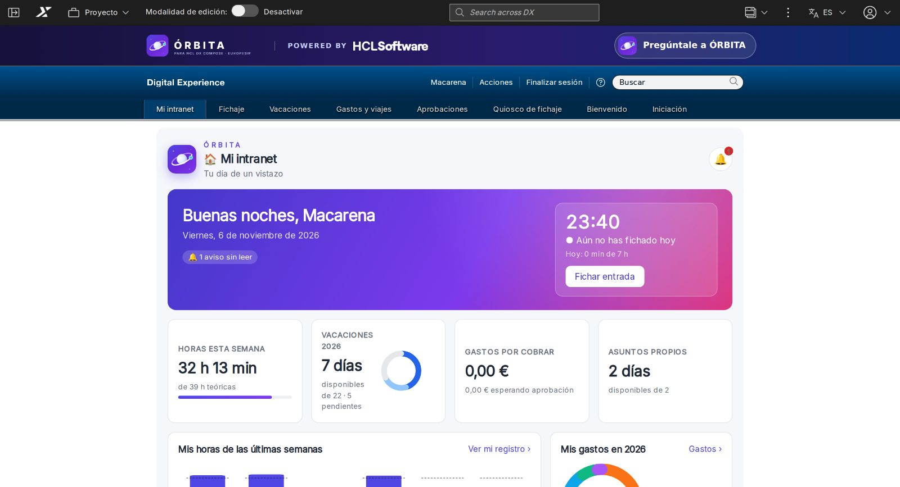

# ÓRBITA · Fichaje, Vacaciones, Gastos y Aprobaciones para HCL DX

[English](index.md) · **Español**

**ÓRBITA** es una suite de intranet para **HCL DX Compose** (CF239) de **EUROPESIP**. Su interfaz React se publica como
seis **Script Applications**; la lógica y los datos viven en una API REST (**`orbita-api`**, Open Liberty) con
PostgreSQL, que incluye además un **servidor MCP** para que **HCL DX IQ** (o el asistente propio de ÓRBITA) responda
preguntas y actúe por el usuario. Todo se instala con **un chart de Helm**, `hcl-dx-orbita`. Software libre y de código
abierto (MIT).



> Esta página es el resumen para el portal del desarrollador. La guía completa (cada valor, el sandbox, las opciones de
> las páginas, la integración con IQ) es el [README en GitHub](https://github.com/europesip/orbita/blob/main/README.es.md).

## Qué hace

| Aplicación | Qué hace el usuario |
|---|---|
| **Mi intranet** | Fichaje rápido, horas de las últimas seis semanas, saldo de vacaciones, gastos por categoría, aprobaciones pendientes, quién falta en los próximos 14 días, últimas notificaciones |
| **Fichaje** | Fichar entrada y salida (oficina, teletrabajo...), correcciones con aprobación |
| **Vacaciones** | Saldo, solicitudes, calendario del equipo |
| **Gastos y viajes** | Hojas de gastos y tickets (OCR en el navegador), envío para aprobación |
| **Aprobaciones** | Aprobar, rechazar y comentar, con conversaciones |
| **Quiosco de fichaje** | Fichar con un PIN o una tarjeta QR |

Cada aplicación tiene el **asistente «✨ Pregúntale a ÓRBITA»**: responde y actúa **como el usuario que pregunta**, con 26
herramientas MCP («¿Cuántos días de vacaciones me quedan?», «Aprueba las vacaciones de macarena»). Ejemplos:
[Qué preguntarle a la IA](preguntas-ia.md).

## Arquitectura

```
 Navegador ── https://<host de DX> ──┬── /wps/...         HCL DX: páginas con las 6 Script Applications (WCM)
                                     └── /orbita-api/v1   Ingress ──► orbita-api (Open Liberty, :9080)
                                                                        │  ¿quién es? ── cookie de sesión de DX ──► API de perfil de DX
                                                                        └─ PostgreSQL: base de datos "orbita" (Flyway)
 Integrator de DX IQ ── cookies de DX del usuario ──► orbita-api :9081 /mcp (solo dentro del clúster)
```

- **Quién es el usuario lo dice DX**: la API reenvía la cookie de sesión de DX del usuario a la API de perfil de DX.
  Sin claves LTPA compartidas, sin configuración LDAP, sin credenciales de administrador de DX en la API.
- **Base de datos**: su propia base de datos y usuario, creados por el chart; tablas creadas y actualizadas con
  migraciones de Flyway. Los datos nunca se borran al actualizar.
- **Servidor MCP**: puerto 9081 del mismo pod, solo para el Integrator de IQ (NetworkPolicy). Las herramientas actúan
  como el usuario del chat de IQ. Detalles: [Servidor MCP](mcp.md).

## Requisitos

| | |
|---|---|
| **HCL DX Compose** | CF239 en Kubernetes, con un Ingress para su nombre de host, y un usuario administrador de DX para DXClient (sube las Script Applications, crea las páginas con XMLAccess). HCL DX tradicional (WebSphere): contacta con EUROPESIP |
| **PostgreSQL** | El tuyo (probado con PostgreSQL 18 / CloudNativePG) con un Secret de superusuario, **o el PostgreSQL que instala HCL DX** para el DAM (`database.type: dxPersistence`) |
| **Usuarios** | Los usuarios de DX de `demo.people` (en los labs, los del OpenLDAP) |
| **IA** (opcional) | Un LiteLLM (o cualquier API compatible con OpenAI) para el asistente propio de ÓRBITA; HCL DX IQ para la integración con el chat de IQ |
| **Imágenes y chart** | Públicos, en `ghcr.io/europesip`: sin login en ningún registro |
| **Herramientas** | `kubectl` y Helm 3.8+ (charts OCI) |

## Instalación, en resumen

1. Secretos: el administrador de DX para DXClient y la CA del certificado de DX.
2. Un fichero de valores (`dx.host`, la base de datos, el namespace de IQ, la configuración de las Script
   Applications, `acceptLicense` de HCL DXClient). Cada valor está explicado en
   [values.yaml](https://github.com/europesip/orbita/blob/main/chart/hcl-dx-orbita/values.yaml).
3. `helm upgrade --install orbita oci://ghcr.io/europesip/charts/hcl-dx-orbita --version <versión> -n <namespace> -f orbita-values.yaml`

Paso a paso, con las dos opciones de base de datos y el sandbox: [Instalación con Helm](https://github.com/europesip/orbita/blob/main/README.es.md#instalación-con-helm).
Las actualizaciones conservan los datos (migraciones nuevas al arrancar); al desinstalar se conservan la base de datos y
las páginas.

## Más documentación

| | |
|---|---|
| [Preguntas frecuentes](faq.es.md) | Instalación, coste y licencia, el tema y el DAM, IA (también tu propia IA soberana), idiomas, seguridad, ediciones de DX |
| [Qué preguntarle a la IA](preguntas-ia.md) | Más de 60 preguntas de ejemplo, por área |
| [Servidor MCP](mcp.md) | Las herramientas, la identidad, cómo lo llama IQ |
| [Especificación funcional](ESPECIFICACION.md) | Aplicaciones, roles, reglas y datos |
| [Cómo trabajamos](workflow.es.md) | Issues, el tablero del proyecto y las especificaciones |
| Manual (PDF) | [Español](manual/orbita-explicada.es.pdf) · [English](manual/orbita-explained.en.pdf) |
| Presentación (PDF) | [Español](presentation/orbita-presentacion.es.pdf) · [English](presentation/orbita-presentation.en.pdf) |
| Código, versiones, hoja de ruta | [GitHub](https://github.com/europesip/orbita) · [Historial de versiones](https://github.com/europesip/orbita/blob/main/CHANGELOG.es.md) · [Hoja de ruta](https://github.com/orgs/europesip/projects/2) |

Licencia: [MIT](https://github.com/europesip/orbita/blob/main/LICENSE) (terceros:
[NOTICE](https://github.com/europesip/orbita/blob/main/NOTICE)). Servicios y contacto:
[EUROPESIP](https://www.europesip.com/es/europesip/contacto).
