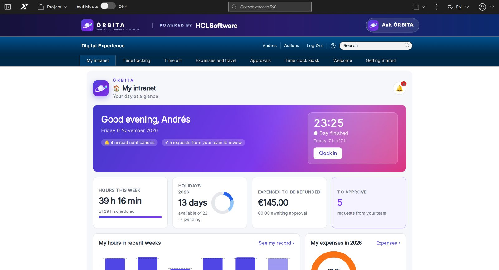

# ÓRBITA · Time tracking, Time off, Expenses and Approvals for HCL DX

**English** · [Español](index.es.md)

**ÓRBITA** is an intranet suite for **HCL DX Compose** (CF239) by **EUROPESIP**. Its React interface is published as
six **Script Applications**; the logic and the data live in a REST API (**`orbita-api`**, Open Liberty) with
PostgreSQL, which also includes an **MCP server** so that **HCL DX IQ** (or ÓRBITA's own assistant) can answer
questions and act for the user. Everything is installed with **one Helm chart**, `hcl-dx-orbita`. Free and open source
(MIT).



> This page is the summary for the developer portal. The complete guide (every value, the sandbox, the options of the
> pages, the IQ integration) is the [README on GitHub](https://github.com/europesip/orbita#readme).

## What it does

| App | What the user does |
|---|---|
| **My intranet** | Quick clock-in, hours of the last six weeks, time-off balance, expenses by category, pending approvals, who is away in the next 14 days, latest notifications |
| **Time tracking** | Clock in and out (office, remote...), corrections with approval |
| **Time off** | Balance, requests, team calendar |
| **Expenses and travel** | Reports and receipts (in-browser OCR), sending them for approval |
| **Approvals** | Approve, reject and comment, with conversations |
| **Time clock kiosk** | Clock in with a PIN or a QR card |

Every app has the **«✨ Ask ÓRBITA» assistant**: it answers and acts **as the user asking**, with 26 MCP tools
(«How many days of holiday do I have left?», «Approve macarena's holidays»). Examples:
[What to ask the AI](ai-questions.md).

## Architecture

```
 Browser ── https://<DX host> ──┬── /wps/...         HCL DX: pages with the 6 Script Applications (WCM)
                                └── /orbita-api/v1   Ingress ──► orbita-api (Open Liberty, :9080)
                                                                   │  who is it? ── DX session cookie ──► DX profile API
                                                                   └─ PostgreSQL: database "orbita" (Flyway)
 DX IQ Integrator ── user's DX cookies ──► orbita-api :9081 /mcp (cluster only)
```

- **Who the user is, DX says**: the API forwards the user's DX session cookie to the DX profile API. No shared LTPA
  keys, no LDAP settings, no DX administrator credentials in the API.
- **Database**: its own database and user, created by the chart; tables created and upgraded by Flyway migrations.
  Data are never dropped on upgrade.
- **MCP server**: port 9081 of the same pod, only for the IQ Integrator (NetworkPolicy). The tools act as the IQ chat
  user. Details: [MCP server](mcp.md) (Spanish).

## Requirements

| | |
|---|---|
| **HCL DX Compose** | CF239 on Kubernetes, with an Ingress for its host name, and a DX administrator user for DXClient (pushes the Script Applications, creates the pages with XMLAccess). Traditional HCL DX (WebSphere): contact EUROPESIP |
| **PostgreSQL** | Your own (tested with PostgreSQL 18 / CloudNativePG) with a superuser Secret, **or the PostgreSQL that HCL DX installs** for DAM (`database.type: dxPersistence`) |
| **Users** | The DX users of `demo.people` (in the labs, the OpenLDAP users) |
| **AI** (optional) | A LiteLLM (or any OpenAI-compatible API) for ÓRBITA's own assistant; HCL DX IQ for the IQ chat integration |
| **Images and chart** | Public, on `ghcr.io/europesip`: no registry login |
| **Tools** | `kubectl` and Helm 3.8+ (OCI charts) |

## Installation, in short

1. Secrets: the DX administrator for DXClient and the CA of the DX certificate.
2. A values file (`dx.host`, the database, the IQ namespace, the Script Application settings, `acceptLicense` of
   HCL DXClient). Every value is explained in
   [values.yaml](https://github.com/europesip/orbita/blob/main/chart/hcl-dx-orbita/values.yaml).
3. `helm upgrade --install orbita oci://ghcr.io/europesip/charts/hcl-dx-orbita --version <version> -n <namespace> -f orbita-values.yaml`

Step by step, with both database options and the sandbox: [Installation with Helm](https://github.com/europesip/orbita#installation-with-helm).
Upgrades keep the data (new migrations at start-up); uninstalling keeps the database and the pages.

## More documentation

| | |
|---|---|
| [FAQ](faq.md) | Installation, cost and licence, the theme and DAM, AI (also your own sovereign AI), languages, security, DX editions |
| [What to ask the AI](ai-questions.md) | More than 60 example questions, by area |
| [MCP server](mcp.md) | The tools, the identity, how IQ calls it (Spanish) |
| [Functional specification](ESPECIFICACION.md) | Apps, roles, rules and data (Spanish) |
| [How we work](workflow.md) | Issues, the project board and specs |
| Manual (PDF) | [English](manual/orbita-explained.en.pdf) · [Español](manual/orbita-explicada.es.pdf) |
| Presentation (PDF) | [English](presentation/orbita-presentation.en.pdf) · [Español](presentation/orbita-presentacion.es.pdf) |
| Source, releases, roadmap | [GitHub](https://github.com/europesip/orbita) · [Release history](https://github.com/europesip/orbita/blob/main/CHANGELOG.md) · [Roadmap](https://github.com/orgs/europesip/projects/2) |

Licence: [MIT](https://github.com/europesip/orbita/blob/main/LICENSE) (third parties:
[NOTICE](https://github.com/europesip/orbita/blob/main/NOTICE)). Services and contact:
[EUROPESIP](https://www.europesip.com/es/europesip/contacto).
